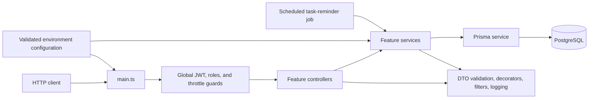

# AppShell

AppShell is a personal backend engineering project built to explore how a modular API can support authentication, user-owned task and project data, and account preferences. It demonstrates NestJS application structure, PostgreSQL data modeling with Prisma, request validation, cookie-based JWT authentication, automated tests, and a Docker-based development setup.

The repository currently contains a backend application in [`backend/`](backend/). It does not include a frontend.

## Tech stack

| Area | Technologies |
| --- | --- |
| Framework and language | NestJS 11, Node.js, TypeScript |
| Database and ORM | PostgreSQL, Prisma |
| Authentication and security | Passport strategies, JWT, bcrypt, Helmet, CORS, request throttling |
| Validation and API documentation | Joi, class-validator, class-transformer, Swagger / OpenAPI |
| Testing | Jest, Supertest |
| Development tools | npm, ESLint, Prettier |
| Containers and CI | Docker, Docker Compose, GitHub Actions |
| Email | Resend |

## Implemented functionality

- **Authentication:** registration, local credential sign-in, access and refresh JWTs delivered in cookies, refresh-token sessions stored in PostgreSQL, token refresh, and logout with session revocation.
- **Email verification:** registration sends a verification email through Resend; expiring verification tokens are stored hashed and can be used to verify an account.
- **Tasks:** authenticated users can create, list, retrieve, update, assign to a project, and delete their own tasks. Listing supports pagination, filtering, and sorting.
- **Projects and tags:** users can manage their own projects and tags; tasks can be assigned to a project and tagged when created or updated.
- **Account preferences:** profile fields and settings such as theme, language, timezone, and notification preferences can be retrieved and updated.
- **Shared API infrastructure:** global authentication and throttling guards, DTO validation, Prisma error mapping, structured application logging, selected audit events, health endpoints, and Swagger documentation.
- **Scheduled reminder prototype:** a configurable cron job processes tasks with pending reminders and records notifications. It does not currently send reminder emails.

## Architecture

The application is organized as NestJS feature modules. Controllers handle HTTP requests, services implement operations, and the database module provides Prisma-backed access to PostgreSQL. Shared guards, decorators, pipes, filters, configuration, and logging support cross-cutting concerns.



Authentication uses a local Passport strategy for credentials and JWT strategies for access and refresh cookies. The refresh strategy validates the persisted session before issuing replacement tokens. The global JWT guard protects routes by default; public routes opt out with a decorator. Request DTOs are validated globally, and the custom validation pipe treats bodies strictly while allowing implicit conversion for query and route parameters. A global Prisma exception filter maps database errors to HTTP responses.

### Current scope and unfinished work

- Password reset is exposed as a route but is not implemented; it returns `NotImplementedException`.
- Role decorators and a role guard exist, but the current user model has no role property. Admin user routes are marked as disabled pending role implementation; role-based authorization should not be considered a completed feature.
- Reminder processing records a notification but does not deliver the reminder email. A session-cleanup cron setting exists, but no cleanup job is currently wired.
- This project is an evolving personal project, not a claim of production readiness.

## Getting started

### Prerequisites

- Node.js 22 and npm (the CI workflow uses Node 22)
- Docker with the Docker Compose plugin

### Configure the environment

From the repository root, copy the example configuration twice:

```sh
cd backend
cp .env.example .env
cp .env.example .env.development
```

Replace the example values in both files with local configuration. The application validates required variables at startup, including JWT secrets of at least 64 characters and a Resend API key. Do not commit real credentials.

For Docker Compose, keep the database hostname in `.env` set to `database`. For commands run directly on your machine, set the database hostname in `.env.development` to `localhost`.

### Install, migrate, and run locally

```sh
npm ci
npm run prisma:generate
docker compose up -d database
npm run prisma:migrate:dev
npm run start:dev
```

Run these commands from `backend/`. The migration command uses the development environment configuration. The API listens on the configured `APP_PORT` (3000 in the example configuration); Swagger UI is available at `/api-docs`.

To run the full containerized stack instead, configure `.env` as above and use:

```sh
docker compose up --build --wait
```

Compose starts PostgreSQL, applies migrations through its migration service, and then starts the backend. See the [backend developer guide](backend/README.md) for test setup and more backend-specific details.

## Tests and quality checks

Run commands from `backend/`:

| Purpose | Command |
| --- | --- |
| Unit tests | `npm test` |
| Unit tests with coverage | `npm run test:cov` |
| End-to-end tests | `npm run test:e2e` |
| Lint | `npm run lint` |
| Build | `npm run build` |

The end-to-end test pre-hook applies migrations to the database configured in `.env.e2e`; point it at an isolated test database. The lint script runs ESLint with `--fix`, so it may modify source files.

## CI

The [GitHub Actions workflow](.github/workflows/test.yml) runs on pushes and pull requests targeting `master`. In a Node 22 container it installs dependencies with `npm ci`, generates the Prisma client, runs the unit test suite, and builds the backend. It does not currently run the end-to-end suite or lint.

## More information

- [Backend developer guide](backend/README.md)
- [Environment variable template](backend/.env.example)
- [Docker Compose configuration](backend/compose.yaml)
- [Portfolio presentation suggestions](PORTFOLIO.md)
